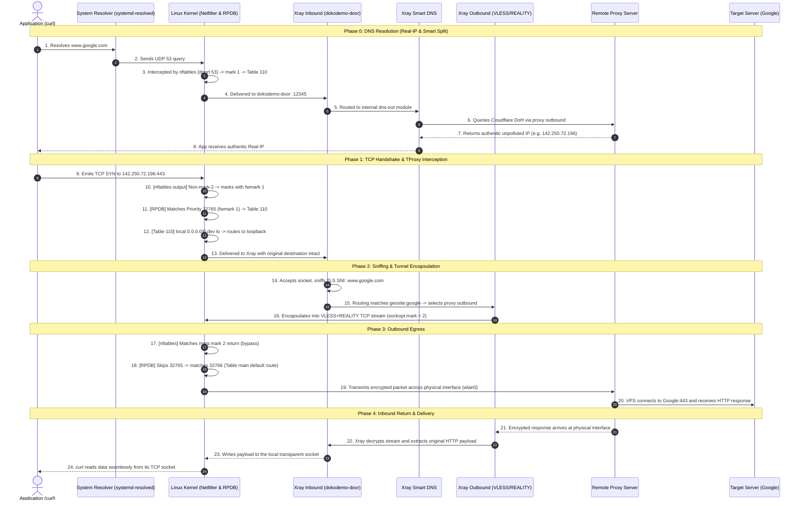

# Data Packet Lifecycle and Traffic Steering

This document explains the end-to-end journey of an application data packet through the transparent proxy system, and details the **three-tier steering and constraint architecture** used to plan, classify, and route traffic safely without loopbacks or leaks.

---

## 1. The Three-Tier Steering and Constraint Architecture

Instead of brute-force global gateway hijacking or heavy virtual TUN interfaces, this system applies a **progressive three-tier filtering and constraint model**:

```text
+-----------------------------------------------------------------------------+
| Layer 1: Kernel Netfilter (nftables)                                        |
| - Fast, coarse-grained packet marking                                       |
| - Loop prevention (mark 2 bypass)                                           |
| - DNS interception priority (port 53 before IP bypass)                      |
| - Local/LAN traffic bypass (10/8, 192.168/16, etc.)                          |
+-------------------------------------+---------------------------------------+
                                      | fwmark 1
                                      v
+-----------------------------------------------------------------------------+
| Layer 2: Kernel Policy Routing (RPDB & FIB Table 110)                       |
| - fwmark 1 matches Priority 32765 rule                                      |
| - Table 110 delivers foreign destinations to `dev lo` via `local default`   |
| - Kernel delivers packet to Xray TProxy socket without changing dst IP:port |
+-------------------------------------+---------------------------------------+
                                      | Delivered to :12345
                                      v
+-----------------------------------------------------------------------------+
| Layer 3: Application Proxy Engine (Xray Core)                               |
| - Inbound: dokodemo-door (IP_TRANSPARENT) recovers original destination     |
| - Sniffing: Extracts TLS SNI, HTTP Host, QUIC Server Name                   |
| - Smart DNS: Local resolver for portals, DoH for foreign domains            |
| - Routing: Fine-grained classification (direct / proxy / blackhole)         |
| - Outbound: Marks tunnel packets with mark 2 (preventing loops)             |
+-----------------------------------------------------------------------------+
```

### What each layer is allowed to decide

The three layers are not three passes over the same decision. Each one answers
a question the others cannot:

- **Netfilter** decides nothing about the destination. It marks candidates for
  interception and exempts what must not be touched — Xray's own outbound
  sockets, the DNS path, ICMP, and anything local. It never looks at a name.
- **Policy routing** decides nothing about the application. It takes a mark and
  hands the packet to loopback *with the original destination intact*, which
  is the single trick that makes a transparent proxy possible: Xray can still
  see where the packet was really going.
- **Xray** decides everything else, because it is the only layer that knows
  domains. Every policy about what to proxy, what to bypass, and how to resolve
  lives here and nowhere else.

Within each layer the order of the rules is load-bearing — in particular, DNS
must be intercepted before the LAN and reserved-range bypasses, or queries on
their way to a router's resolver travel in plaintext. The exact rule order,
mark values, route contents and DNS server list are lookup material, not
architecture: see the
[Traffic Selection Reference](../reference/traffic-selection.md) and
[Real-IP DNS Architecture](dns.md).

---

## 2. End-to-End Round-Trip Lifecycle (Packet Perspective)

Consider a typical request, e.g. `curl https://www.google.com`:



---

## 3. System Invariants

Four properties hold at all times, and each one is why a whole class of bug
cannot happen here.

1. **Loop-free.** Xray's own outbound sockets are marked, and that mark is the
   first thing both nftables chains test. A tunnel packet therefore cannot be
   intercepted a second time, whatever else the ruleset contains.
2. **No plaintext DNS escape.** Port 53 is intercepted before any IP-range
   bypass, so a query aimed at a local ISP resolver is still resolved through
   Xray, and a poisoned answer from an uplink middlebox is never reachable.
3. **The host's own routing is untouched.** Table `main` and the default
   gateway are never rewritten; the proxy lives entirely in a separate routing
   table. Stopping the service therefore restores direct networking in one
   step instead of by undoing a rewrite.
4. **No stale tunnels.** Keepalive is configured on every outbound, so a
   connection whose peer vanished during a suspend or a Wi-Fi roam is detected
   and replaced rather than stalling the application's socket.

What implements each invariant — rule order, mark values, route contents,
keepalive settings — is lookup material:
[Traffic Selection Reference](../reference/traffic-selection.md) and
[Host Artifacts Reference](../reference/host-artifacts.md).
